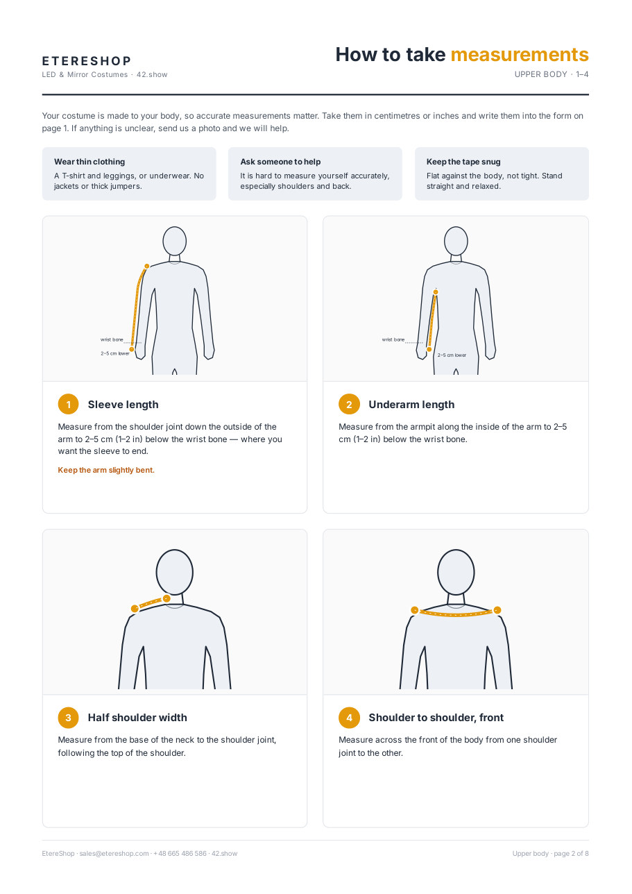
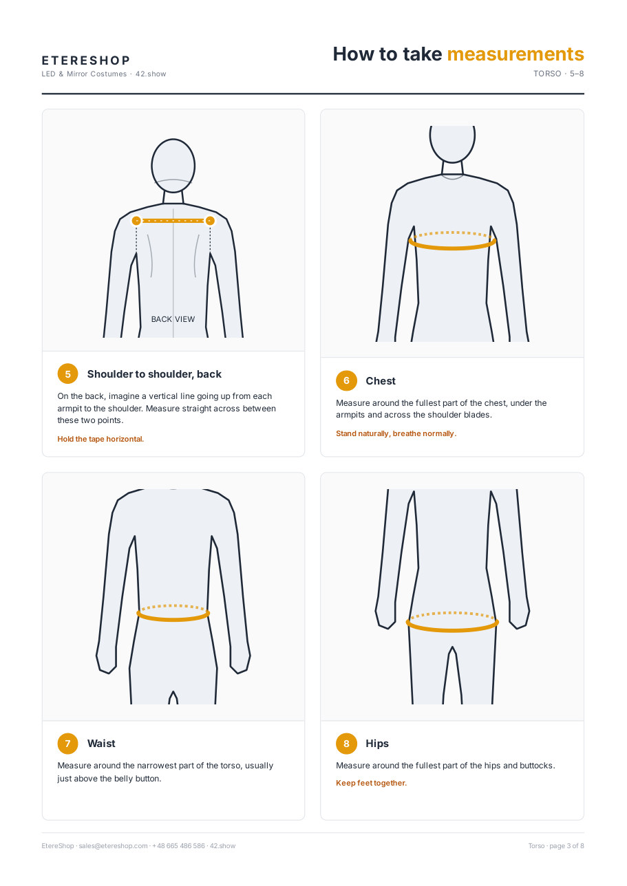
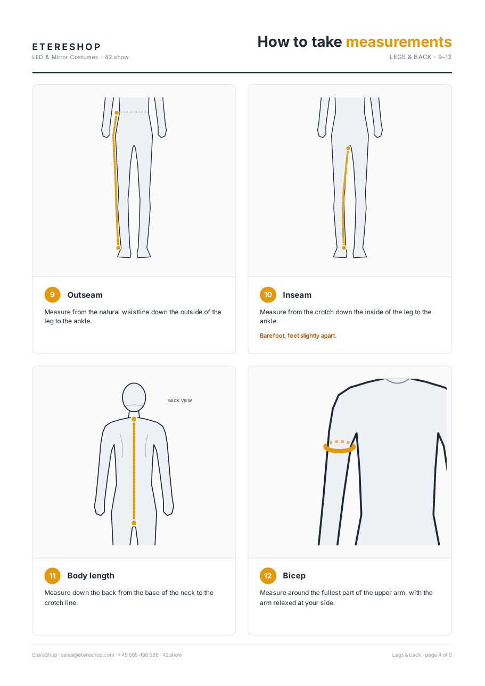
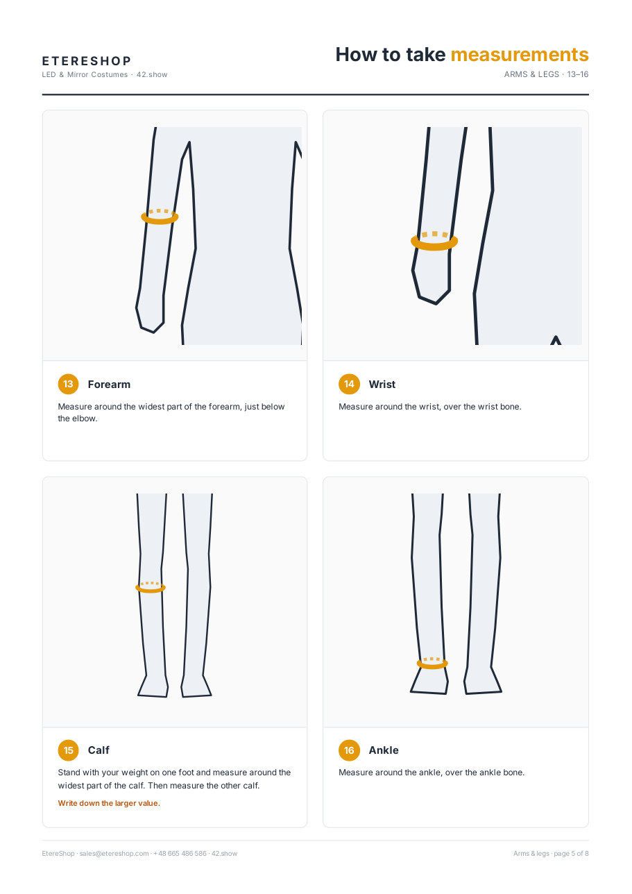
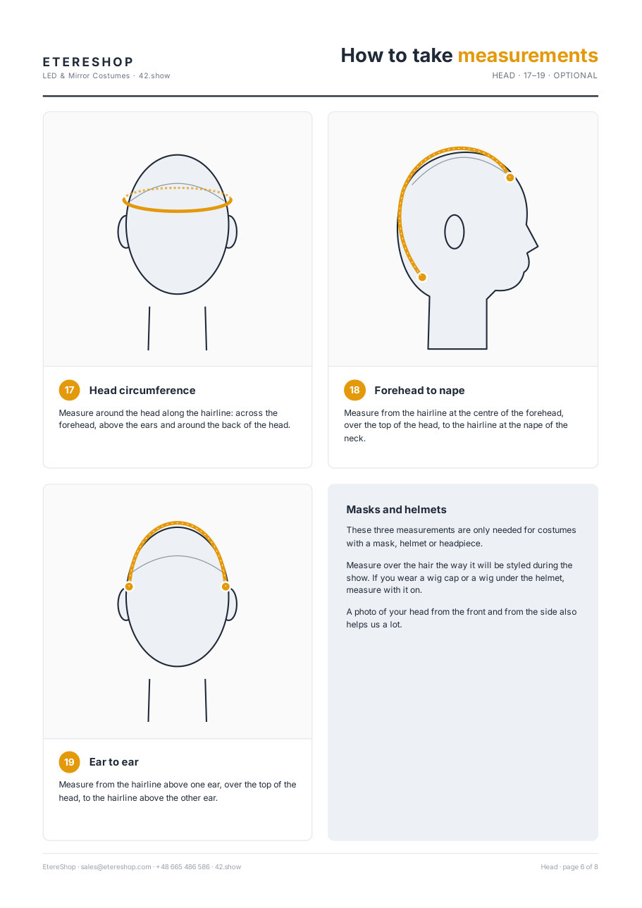
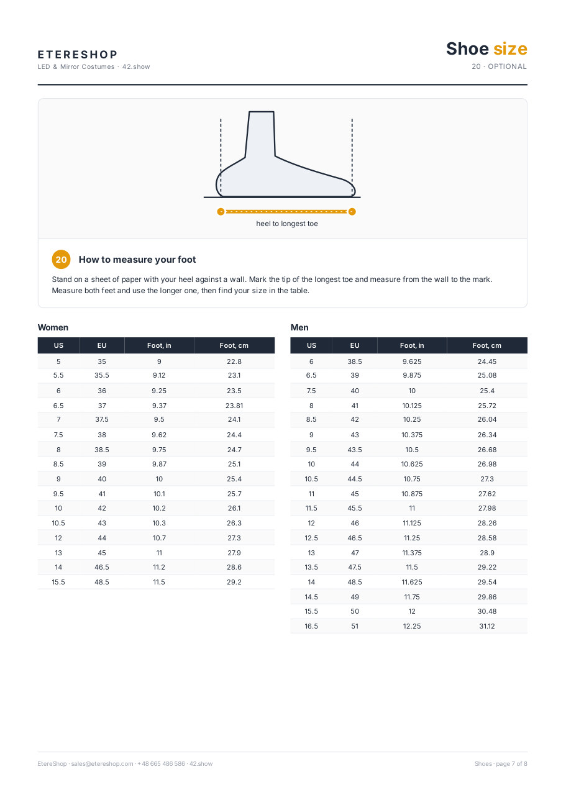
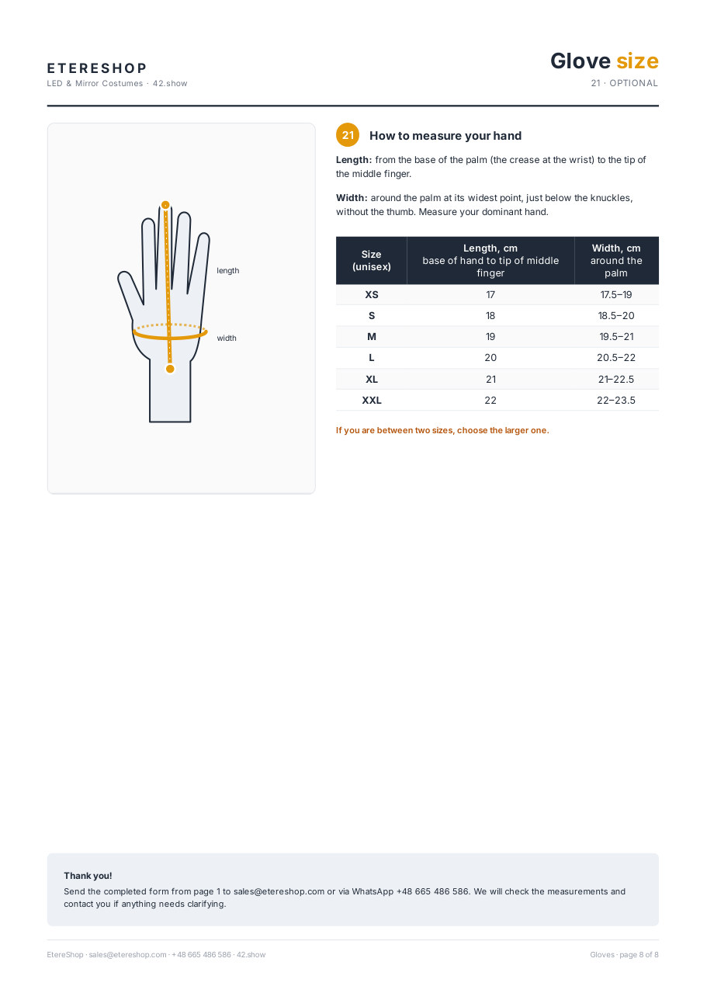

# How to take all measurements

Your costume is made to your body, so accurate measurements matter. Below you will find the list of measurements we need and illustrated instructions for each of them.

📥 **Download the measurement form:**
- [**PDF with fillable form and instructions**](https://github.com/etereshop-sales/How-to-take-all-measurements/raw/main/downloads/How-to-take-measurements-EtereShop.pdf) (recommended)
- [DOCX](https://github.com/etereshop-sales/How-to-take-all-measurements/raw/main/downloads/measurements-form.docx) · [XLSX](https://github.com/etereshop-sales/How-to-take-all-measurements/raw/main/downloads/measurements-form.xlsx) · [TXT](https://github.com/etereshop-sales/How-to-take-all-measurements/raw/main/downloads/measurements-form.txt)

Fill in the form and send it back to us by e-mail or WhatsApp. Please tell us whether you measured in centimetres or inches.

## Before you start

- **Wear thin clothing** — a T-shirt and leggings, or underwear. No jackets or thick jumpers.
- **Ask someone to help** — it is hard to measure yourself accurately, especially shoulders and back.
- **Keep the tape snug** — flat against the body, not tight. Stand straight and relaxed.

## Measurement form

| #  | Measurement                         | Value |
|----|-------------------------------------|-------|
|    | **Height**                          |       |
|    | **Weight**                          |       |
| 1  | Sleeve length                       |       |
| 2  | Underarm length                     |       |
| 3  | Half shoulder width                 |       |
| 4  | Shoulder to shoulder, front         |       |
| 5  | Shoulder to shoulder, back          |       |
| 6  | Chest                               |       |
| 7  | Waist                               |       |
| 8  | Hips                                |       |
| 9  | Outseam                             |       |
| 10 | Inseam                              |       |
| 11 | Body length                         |       |
| 12 | Bicep                               |       |
| 13 | Forearm                             |       |
| 14 | Wrist                               |       |
| 15 | Calf                                |       |
| 16 | Ankle                               |       |
|    | **Optional — for costumes with masks, helmets, shoes or gloves** | |
| 17 | Head circumference                  |       |
| 18 | Forehead to nape                    |       |
| 19 | Ear to ear                          |       |
| 20 | Shoe size *(see the chart below)*   |       |
| 21 | Glove size *(see the chart below)*  |       |

## How to take the measurements

<strong>Body measurements (1–16)</strong>

<strong>Optional measurements (17–21) — for costumes with masks, helmets, shoes or gloves</strong>

## Questions?

If you are not sure about a measurement, leave it empty and send us a photo — we will help.

EtereShop · [sales@etereshop.com](mailto:sales@etereshop.com) · WhatsApp [+48 665 486 586](https://wa.me/48665486586) · [42.show](https://42.show/)
